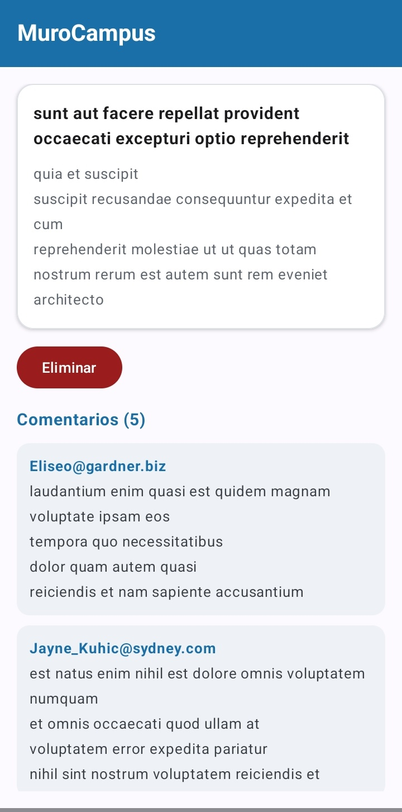
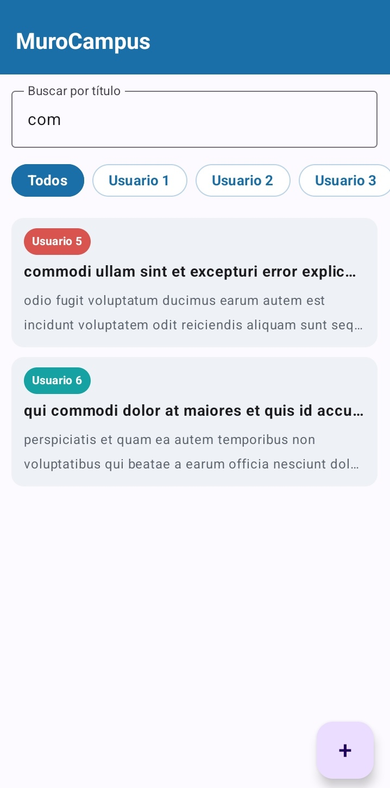
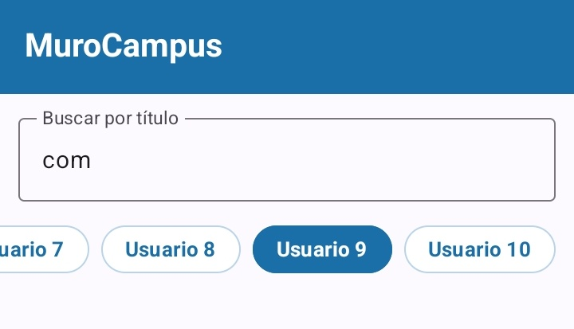

# PROMPTS.md – Fase 2 (rama mejora-ia)

Mejoras hechas con ayuda de Gemini en Android Studio, sin romper MVVM + Repository:

1. **Encabezado con interceptor** – `RetrofitClient` (Accept: application/json en todas las peticiones).
2. **Borrar publicación** – `@DELETE("posts/{id}")` con `Response<Unit>`: API + Repository + ViewModel + View.
3. **Búsqueda por título** – filtra las publicaciones ya descargadas: ViewModel + View.

| Prompt que escribí | Qué respondió Gemini | Qué cambié o descarté | Por qué |
|---|---|---|---|
| «Agrega un Interceptor de OkHttp en RetrofitClient que ponga el encabezado Accept: application/json en todas las peticiones» | Un `Interceptor` que usa `addHeader("Accept", ...)` y lo agrega al `OkHttpClient.Builder()` | Usé `header(...)` en vez de `addHeader(...)` y lo puse antes del `HttpLoggingInterceptor` | `header` reemplaza el valor si ya existe y no lo duplica; al ir antes del logging, en Logcat se ve el encabezado ya agregado |
| «Agrega un botón Eliminar en el detalle que borre la publicación con @DELETE posts/{id}» | Una función `@DELETE` que devolvía `Unit` y en el Composable llamaba a `RetrofitClient.api.borrar(id)` dentro de un `rememberCoroutineScope` | Descarté llamar a la API desde el Composable. Cambié el retorno a `Response<Unit>`, agregué `borrar()` al `PostRepository` y `borrar()` en el `PostsViewModel` con su propio `UiState` | La pantalla nunca debe llamar a la API y el ViewModel no debe conocer Retrofit. Con `Response<Unit>` se revisa `isSuccessful` y si falla se convierte en `HttpException` dentro del Repository |
| «En el Repository, cómo manejo el error del DELETE si el código no es 200» | Un `try/catch` con `catch (e: Exception) { }` vacío que devolvía `Result.success(Unit)` igual | Lo reemplacé por mi función `llamar { }` que ya relanza `CancellationException` y devuelve `Result.failure(e)` | Un catch vacío traga el error: el usuario vería que se borró aunque el servidor haya fallado |
| «Después de borrar, la publicación sigue apareciendo en la lista, por qué» | Explicó que JSONPlaceholder solo simula el DELETE y propuso volver a llamar a `cargar()` | No recargué: en el ViewModel quito el post de la lista que ya está en `UiState.Exito` y regreso a la lista | Si recargo, JSONPlaceholder devuelve otra vez las 100 y el post “vuelve”; quitarlo de la lista local refleja lo que haría un servicio real |
| «Agrega un campo de búsqueda que filtre las publicaciones por título» | Un `TextField` que en cada letra llamaba a la API con un nuevo endpoint `posts?title_like=` | Descarté el nuevo endpoint. Guardo el texto en un `StateFlow` del ViewModel y filtro con `aplicarBusqueda()` sobre la lista ya descargada | El reto pide filtrar lo ya descargado; llamar a la red en cada letra es lento y gasta datos. La búsqueda también respeta el filtro por usuario |

## Reglas que revisé en todo lo que generó la IA

- Nada de Retrofit, `PostApi` ni `HttpException` en `PostsViewModel`.
- Ninguna pantalla llama a la API: todo pasa por el ViewModel y el Repository.
- Sin `GlobalScope`: solo `viewModelScope`.
- Sin catch vacíos y la URL sigue siendo `https://`.

## Capturas de las mejoras

| Eliminar en el detalle | Búsqueda por título | Búsqueda + filtro por usuario |
|---|---|---|
|  |  |  |
