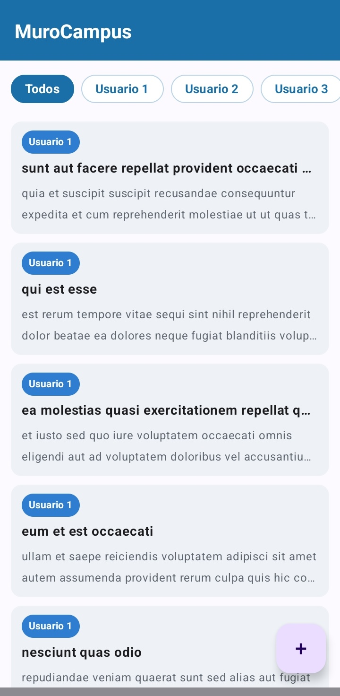
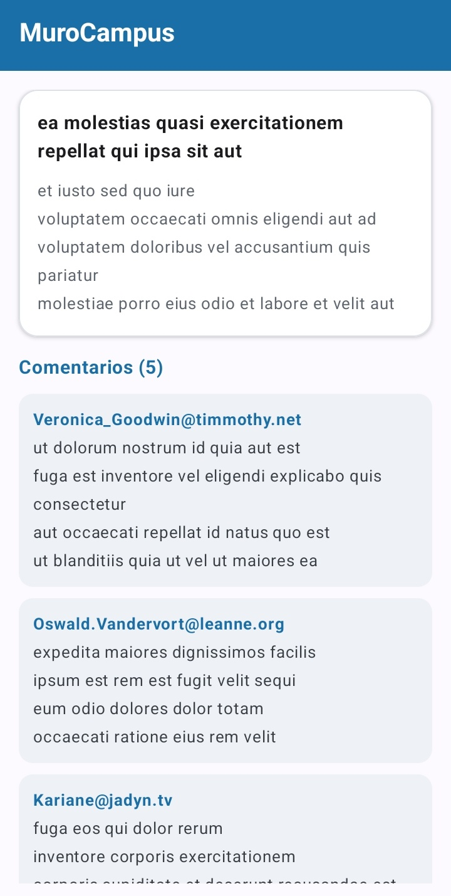
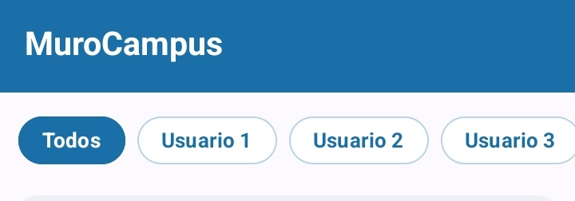
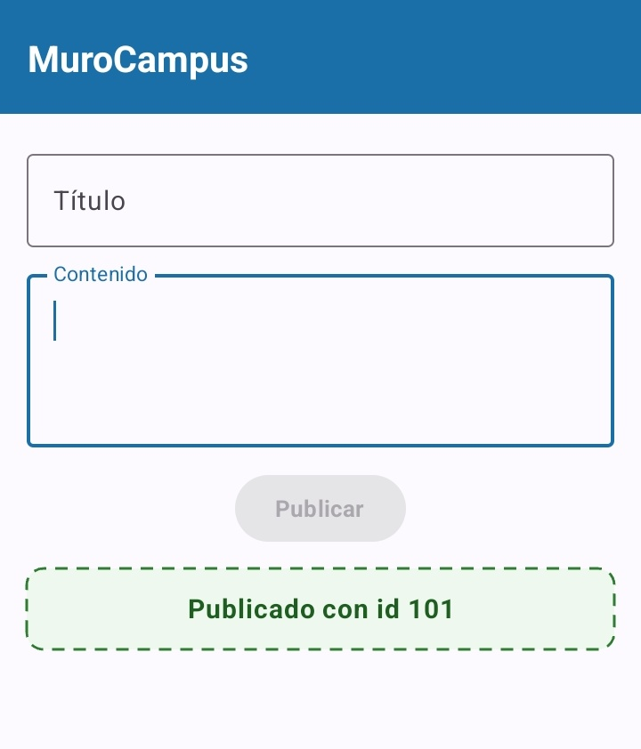
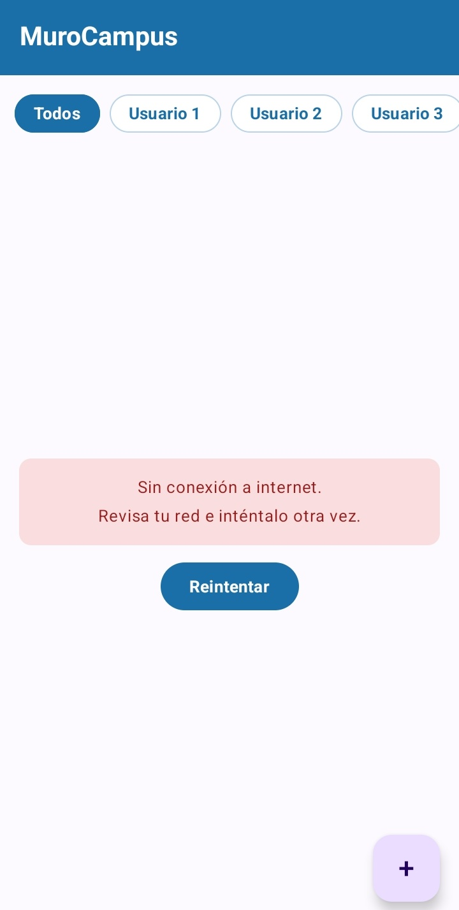

# MuroCampus

App Android (Kotlin + Jetpack Compose) que consume el servicio web REST **JSONPlaceholder**.
Lista publicaciones, muestra el detalle con sus comentarios, filtra por usuario y crea una
publicación nueva. Si no hay internet muestra un mensaje de error con el botón **Reintentar**
y la app no se cierra.

- **Alumno:** José Rojas Condor
- **Curso:** Programación en Móviles – 4to ciclo, Diseño y Desarrollo de Software (TECSUP)
- **Laboratorio:** Semana 09 – Servicios Web y plataforma REST
- **API:** https://jsonplaceholder.typicode.com/

## Tecnologías

| Librería | Para qué se usa |
|---|---|
| Retrofit 2.11.0 | Convierte la interface `PostApi` en llamadas HTTP |
| OkHttp 4.12.0 + logging-interceptor | Hace la conexión y muestra el tráfico en Logcat |
| kotlinx.serialization 1.7.3 | Convierte el JSON en `data class` |
| lifecycle-viewmodel-compose / runtime-compose | ViewModel y `collectAsStateWithLifecycle()` |

## Estructura de paquetes

```
com.rojas.murocampus/
├── MainActivity.kt              navegación (lista / detalle / crear) y barra superior
├── model/
│   └── Modelos.kt               Post, Comentario, NuevoPost (+ Usuario)
├── data/
│   ├── remote/
│   │   ├── PostApi.kt           interface de Retrofit (@GET, @POST, @Path, @Query, @Body)
│   │   ├── RetrofitClient.kt    cliente único con OkHttp y conversor JSON
│   │   └── UsuarioApi.kt        ejemplo resuelto
│   ├── PostRepository.kt        interface + PostRepositoryRemote (devuelve Result)
│   └── UsuarioRepository.kt     ejemplo resuelto
├── viewmodel/
│   ├── UiState.kt               Cargando / Exito / Error + mensajeDe()
│   ├── PostsViewModel.kt        lista, detalle, filtro y crear
│   └── PostsViewModelFactory.kt
└── ui/
    ├── Componentes.kt           TarjetaPost, Cargando, ErrorConReintento
    ├── PantallaLista.kt
    ├── PantallaDetalle.kt
    ├── PantallaCrear.kt
    └── theme/
```

## Arquitectura MVVM + Repository

```
View (PantallaLista, PantallaDetalle, PantallaCrear)
  | eventos: cargar, filtrar, publicar        ^ collectAsStateWithLifecycle()
  v                                           |
ViewModel (PostsViewModel) --- StateFlow<UiState> (Cargando / Exito / Error)
  | viewModelScope.launch
  v
PostRepository (interface)        <- devuelve Result<...>
  -> PostRepositoryRemote          (captura IOException, HttpException...)
  |
  v
PostApi (Retrofit) --- OkHttp ---> https://jsonplaceholder.typicode.com/
```

- La pantalla solo conoce a su ViewModel y dibuja el estado con un `when`.
- El ViewModel solo conoce la interface `PostRepository` (no usa Retrofit, PostApi, HttpException ni Context).
- El Repository nunca deja escapar una excepción: la convierte en `Result.failure` (menos la `CancellationException`, que se vuelve a lanzar).

## Endpoints usados

| Acción | Verbo y ruta |
|---|---|
| Listar publicaciones | `GET posts` |
| Ver una publicación | `GET posts/{id}` |
| Ver sus comentarios | `GET posts/{id}/comments` |
| Filtrar por usuario | `GET posts?userId=2` |
| Crear publicación | `POST posts` (JSON en el cuerpo) |

## Capturas

| Lista | Detalle | Filtro |
|---|---|---|
|  |  |  |

| Crear | Error de conexión |
|---|---|
|  |  |

## Pruebas de errores

| Prueba | Resultado esperado | OK |
|---|---|---|
| Sin internet (modo avión) | "Sin conexión a internet" y botón Reintentar | ✔ |
| Reintentar | Carga la lista | ✔ |
| Recurso inexistente (posts/9999) | "Error del servidor (404)" | ✔ |
| JSON inesperado | Funciona por `ignoreUnknownKeys`; con un campo que no llega: "Respuesta inesperada" | ✔ |
| Cancelación (abrir detalle y volver rápido) | Sin errores en Logcat | ✔ |
| Lista y detalle | Siempre 5 comentarios | ✔ |
| Filtro | Siempre 10 publicaciones | ✔ |
| Crear | "Publicado con id 101" | ✔ |
| Código del viewmodel/ | Sin Retrofit, PostApi ni HttpException en PostsViewModel | ✔ |

## Para pensar

**1. ¿Qué diferencia hay entre GET y POST? ¿Por qué crear lleva @Body y porUsuario lleva @Query?**
GET solo lee datos del servidor y no cambia nada; POST envía datos para crear un recurso nuevo.
`crear` lleva `@Body` porque la publicación completa (userId, title, body) viaja como JSON en el
cuerpo de la petición. `porUsuario` lleva `@Query` porque el userId solo es un filtro que se agrega
a la URL (`posts?userId=2`); un GET no lleva cuerpo.

**2. ¿Por qué la ruta es "posts" y no "/posts"?**
Porque Retrofit une la ruta con la `baseUrl`. Si la ruta empieza con `/` se toma como ruta absoluta
desde la raíz del dominio y reemplaza el camino que tenga la URL base. Con `"posts"` se agrega al
final de `https://jsonplaceholder.typicode.com/`, que por eso termina en `/`.

**3. ¿Por qué el Repository devuelve Result en vez de dejar que la excepción llegue al ViewModel?**
Para que el ViewModel no tenga que saber qué excepciones lanza Retrofit ni OkHttp. Con `Result`
el ViewModel solo pregunta si salió bien (`onSuccess`) o mal (`onFailure`) y lo convierte en un
`UiState`. Así ninguna excepción cierra la app y se puede cambiar la fuente de datos (por ejemplo
Room) sin tocar el ViewModel ni las pantallas.

**4. ¿Qué pasa si olvidas el permiso INTERNET? ¿Y si olvidas ignoreUnknownKeys y el servidor agrega un campo nuevo?**
Sin el permiso la app compila, pero Android bloquea la conexión: todas las llamadas fallan con un
error de red y se ve "Sin conexión a internet" aunque sí haya internet. Sin `ignoreUnknownKeys`,
cuando el JSON trae un campo que no está en la `data class`, kotlinx.serialization lanza
`SerializationException` y se muestra "Respuesta inesperada", aunque los datos que sí usamos estén bien.

**5. ¿Por qué la pantalla de lista usa un when sobre UiState y no un if con tres variables?**
Porque `UiState` es una `sealed interface`: la pantalla solo puede estar en un estado a la vez
(Cargando, Éxito o Error) y el `when` obliga a cubrir los tres casos. Con tres variables
(`cargando`, `datos`, `error`) podrían quedar combinaciones imposibles, como cargando y error a la vez.

**6. JSONPlaceholder no guarda los POST. ¿Cómo cambiaría tu app si usaras un servicio real?**
Después de publicar, la publicación nueva sí aparecería al recargar la lista, así que habría que
volver a llamar a `cargar()` o agregar el post devuelto a la lista. También habría que manejar
autenticación (token en un encabezado con un Interceptor), validaciones del servidor (errores
400/401/422) y posiblemente guardar una copia local (Room) para usar la app sin internet.

## Cómo ejecutar

1. Abrir el proyecto en Android Studio y hacer **Sync Now**.
2. Ejecutar en un emulador o celular con internet.
3. En Logcat filtrar por `OkHttp` para ver las peticiones y respuestas.
